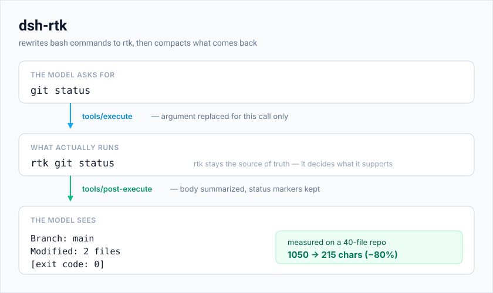
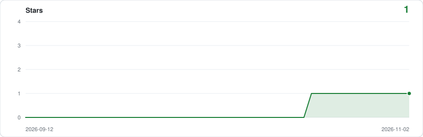

# dsh-rtk

[](https://github.com/wings1848/dsh-rtk/actions/workflows/ci.yml)
[](https://github.com/wings1848/dsh-rtk/actions/workflows/codeql.yml)
[](https://github.com/wings1848/dsh-rtk/actions/workflows/secrets.yml)
[](https://www.npmjs.com/package/@wingsbutterfly/dsh-rtk)
[](https://github.com/wings1848/dsh-rtk/blob/main/LICENSE)
[](https://nodejs.org)
[](https://github.com/wings1848/dsh-rtk/blob/main/README.zh.md)

RTK command rewriting and tool-output compaction for the [DeepSeek Harness](https://github.com/deepseek-ai/dsh).

`dsh-rtk` rewrites shell commands to their [rtk](https://github.com/rtk-ai/rtk) equivalents before they run, and compacts noisy tool output before it reaches the model. Rewriting covers `bash`, `pwsh`, and dsh-ops' `ops_bash`; compaction covers `bash`, `read`, `grep`, `ops_bash`, and `ops_grep`. It is a port of [`pi-rtk-optimizer`](https://github.com/MasuRii/pi-rtk-optimizer) to the harness's plugin model; on the Web harness it also contributes a row configuration page and an rtk savings panel.

```
model asks:  git status
runs:        rtk git status
model sees:  Branch: main
             Modified: 2 files
               src/a.ts
```



## Features

### Command rewriting

- Every command with an rtk equivalent is rewritten before dispatch; commands rtk does not support run untouched.
- **rtk stays the source of truth.** The plugin carries no rewrite table of its own — it asks the installed binary via `rtk rewrite`, so support tracks whatever rtk version is installed.
- **`off`, `rewrite`, and `suggest` modes.** `off` disables rewriting and compaction entirely; `rewrite` replaces the command; `suggest` runs it unchanged and reports the equivalent it would have used.
- **Runtime guard.** A call that cannot prove rtk is available runs the original command. A missing optimizer never blocks work.
- **Credential-free child processes.** `rtk` is spawned with the harness's own scrub rule: credential-shaped names (`*_KEY`, `*_PASSWORD`, `*_SECRET`, `*_TOKEN`) and `DSH_*` are dropped, `PATH`, locale, and proxy settings are kept, and the ledger path is forwarded explicitly.
- Rewritten commands never write rtk's usage history into the working tree: by default they inherit rtk's own user-level database, and `historyDbPath` can pin an exact location.

### Row configuration page

The package ships a browser half (`exports["./client"]` and `dsh.client`), so the Web **Plugins** page grows a **Configure** control on the `rtk` row. The page renders the everyday fields, stages edits locally, commits them through the host settings service — the same user layer `/rtk reset` clears — and marks overridden fields with a per-field reset. Current values stay readable even before the host has answered, and the Save button disables itself while a write is in flight.

### Savings panel

Below the form, the Configure page shows what rtk reclaimed: a 20-cell efficiency meter, original output / after rtk / saved (with the share), command count and average time, and a breakdown that switches between **by day** and **by command**. Values are read on the host by running `rtk gain -d -f json` against the ledger actually in effect for this session and are served to the browser through an exact Fetch route under the Web connection's authenticated `/api` prefix (`POST /api/dsh-rtk/gain`). Reports are sliceable by **workspace** (`rtk gain -p`; the picker prefers the host's `workspaceRegistry`, falling back to the ledger's `project_path` history) and by **time** (today / last 7 days / last 30 days / all time, filtered in UTC to match rtk's own day grouping). Cached for 30 seconds; the refresh button bypasses the cache. A deployment without a Web connection reports the ledger as unavailable instead of rendering a broken page.

### Output compaction

A multi-stage pipeline over `bash`, `read`, `grep`, `ops_bash`, and `ops_grep` results:

| Stage | What it does |
|---|---|
| ANSI stripping | Removes terminal color and formatting sequences |
| Build filtering | Extracts compiler errors and warnings, drops progress chatter |
| Test aggregation | Collapses runner output to pass/fail/skip plus failure excerpts |
| Git compaction | Summarizes `git status`, `git diff`, and `git log` |
| Linter aggregation | Counts issues and ranks them by rule and file |
| Search grouping | Groups `grep`-style matches by file |
| Read compaction | `readCompaction: minimal` drops plain comments; `aggressive` keeps only imports and signatures (off by default) |
| Hard truncation | Final character budget |

Two properties are load-bearing:

- **The harness contract survives.** A `bash` result ends with status markers — `[exit code: N]`, `[stderr]`, `[timed out after …]`, `[sandbox: …]`. Compaction lifts those out before rewriting the body and puts them back afterwards; the model is told to check `[exit code: N]` on every call, and the Web UI parses that same line for its exit-status pill.
- **Compaction never inflates a result.** If a technique would not actually shrink the text, the original is kept and nothing is reported.

dsh-ops renders its Rust tool results as a single `JSON.stringify` line, which the match-list heuristic would mis-read as "1 matches in 1 files"; `ops_grep` therefore leaves JSON bodies byte-exact.

### Oversized output belongs to the harness

When `dsh-spill-policy` is mounted, it writes a full result to disk and keeps a head/tail preview inline — that truncation is **recoverable**. This plugin's own hard truncation is not, and it runs first: at its 12 000-character default it fires far below spill's 50 000-byte threshold, so spill never sees a large result at all and the file that would have let a reader see the rest is never written.

So when the spill service is present the plugin turns its own truncation off, and a runaway command's output stays readable. Whether to defer is read from the service being mounted, not from a setting.

### Session metrics

`/rtk stats` reports how many characters compaction saved, per tool and per technique. `/rtk gain [flags]` shows what rtk itself reclaimed for the commands this plugin rewrote.

## Install

**Supported harness:** dsh 0.1.5, 0.1.7, 0.2.0, 0.2.1 — each verified, evidence in
[`docs/verification.md`](docs/verification.md). Node ≥ 22.18.

### 0. Prerequisite: install the rtk binary

**`dsh-rtk` is a plugin around rtk, not a replacement for it.** Without the `rtk`
executable on `PATH` there is nothing to rewrite commands to and nothing to
compact with, so the plugin stands down: commands run unchanged, output is not
compacted, and nothing appears to happen. That is the one failure you cannot see
from the outside — a session gets a single line about it
(`[rtk] rtk not found; rewriting is off`), easy to miss inside a tool result.

Install it first:

```bash
brew install rtk                        # macOS / Linux (Homebrew, recommended)
winget install rtk-ai.rtk               # Windows
curl -fsSL https://raw.githubusercontent.com/rtk-ai/rtk/refs/heads/master/install.sh | sh
cargo install --git https://github.com/rtk-ai/rtk
```

> **Do not run plain `cargo install rtk`.** crates.io carries an unrelated crate
> of that name; only the `--git` form above installs this tool.

Verify before going further — this must print a version:

```bash
rtk --version
```

`/rtk verify` reports the same thing from inside a session, and prints these
install options when it fails. The plugin also fills `rtkExecutable` in
automatically (see [Configuration](#configuration)), so a binary that is
installed but not on the harness's `PATH` is still found on Windows.

### 1. Install the package

```bash
dsh plugin --profile web add @wingsbutterfly/dsh-rtk
```

The package declares `dsh.bundle.patch` (see [`cordis.patch.yml`](cordis.patch.yml)), so this command **installs and mounts it in one step**: the plugin manager appends the package to the profile's bundle stack, and the bundle layer inserts the host-plane row

```yaml
- id: rtk
  name: '@wingsbutterfly/dsh-rtk'
```

Restart the host afterwards — profile rows are mounted at boot.

> **Scope: a host-plane row covers every session in that profile.** The row is
> instantiated once per host process, and the `tools/execute` /
> `tools/post-execute` listeners it registers are process-global: rewriting and
> compaction apply to every agent, preset, and subagent in the profile. A bundle
> patch cannot express per-preset opt-in — it can only append rows to the root
> entry list, and the loader cannot extend `preset-*.config.plugins`. Use the
> row's own switches to narrow it: `mode: off` disables everything,
> `mode: suggest` only reports.

The row also ships display metadata (`locale/en.json`, `locale/zh.json`, and an
original `icon.svg`), so the Plugins page shows a real name, description, and
artwork instead of the bare package id.

### Per-preset instead of global

To keep rewriting out of the whole profile, skip the bundle channel: install the
package as a plain dependency, add the row to the target preset's plugin list by
hand, and make sure the package name is **not** in `dsh.profile.bundles` (delete
it there if the CLI already added it). **Do not mount both.** In this mode the
plugin manager shows "installed, not active" — that is expected, and it is the
only state on this path that is not a problem.

```yaml
- id: rtk
  name: '@wingsbutterfly/dsh-rtk'
  config:
    mode: rewrite
```

To try it without touching an existing preset, copy one and add the row:

```
# ask a cordis-preset agent to run this
agentPresets.copy('standard', 'rtk', 'RTK 优化')
```

Working from a checkout instead? Link it where the composition resolves bare
specifiers:

```bash
mkdir -p ~/.dsh/node_modules/@wingsbutterfly
ln -s /path/to/dsh-rtk ~/.dsh/node_modules/@wingsbutterfly/dsh-rtk
```

### Machine-specific settings

The shipped patch carries portable defaults only. Machine-specific values such as
an absolute `rtkExecutable` belong in the profile's own `cordis.patch.yml`, as a
**non-insert** override. Restate the whole `config:` block — a patch replaces a
row's config wholesale rather than merging it:

```yaml
- id: rtk
  config:
    mode: rewrite
    rtkExecutable: /opt/rtk/bin/rtk
```

### Upgrading from a manual mount

If the profile's `cordis.patch.yml` still has the hand-written `- insert:` row
from before the bundle channel existed, installing the bundle mounts the same row
twice. Delete the manual insert block and keep only the non-insert override
above.

## Configuration

Every field is optional; defaults are shown.

```yaml
- id: rtk
  name: '@wingsbutterfly/dsh-rtk'
  config:
    mode: rewrite                    # off | rewrite | suggest
    compact: true                    # compact tool output
    maxChars: 12000                  # character budget (1000–200000)
    readCompaction: none             # none | budget | minimal | aggressive
    rtkExecutable: rtk               # name or absolute path; empty = auto-detect
    historyDbPath: ''                # '' = rtk's own database; or an absolute/~ path, or `isolated`
```

> **Upgrading from the old schema.** Retired fields are migrated rather than silently ignored: `enabled: false` → `mode: off`, `outputCompaction.enabled` → `compact`, `truncate.maxChars` → `maxChars`, and the three read-compaction fields collapse into the single level (`off` → `none`; on with `minimal`/`aggressive` → that level; on without filtering → `budget`). Every other removed switch now sits at its previous default; spill deferral became "the service is mounted or it is not" instead of a setting. Migration only looks at whether a new field is still at its schema default, so a user who happened to set a new field *to* the default is indistinguishable from one who never set it — that boundary is inherent to the migration.

`rtkExecutable` is filled in **automatically**: at load time the plugin looks it up on `PATH`, and on Windows also checks the usual WinGet, cargo, and Scoop install directories — running each candidate with `--version` before trusting it. A path it finds is written back into the setting (so the Configure page shows it); when nothing is found the field is written empty, meaning "auto". A hand-typed value is never overwritten.

The configuration is also editable live in the harness settings document, and takes effect without a restart. Where it appears depends on the harness generation: on dsh 0.1.7+ the row shows up as its own settings entry, named after the composition row's id (the example above: `rtk`), with the everyday fields editable in the settings document and in the Configure page; on dsh 0.1.5 it is the `dsh-rtk` namespace. Either way a composition `config:` block supplies the base layer and the settings document supplies the user layer on top — `/rtk path` reports which one this plugin can see. A settings service of an unknown generation costs the live editing only: the plugin degrades to composition-only configuration instead of failing to load, and a composition with no settings service at all still gets rewriting and compaction.

> **The Configure page edits the five everyday fields.** `historyDbPath` is deliberately not in the form: it is a layout decision, not a knob, and a bad value is refused with a warning rather than silently rewritten. Set it in the composition or the settings document.

> **Where the row lives decides whether settings are writable (dsh 0.1.7+).** A row in the home patch (`~/.dsh/cordis.patch.yml`) is read-only there: the service refuses writes a lower layer would override, and `/rtk reset` reports that refusal honestly. Put the row in a profile composition to keep live editing.

> **Why `readCompaction` is off by default.** Filtering or truncating a `read` result can leave the model editing against text that no longer matches the file. Everything on by default is lossless for the body text it summarizes, or only fires on outputs whose whole shape is being replaced. `budget` bounds a `read` result by `maxChars` without touching source text; `minimal` and `aggressive` filter it.

> **Where rtk keeps its usage ledger, and why the default is "don't touch it".** Rewritten commands run under `RTK_DB_PATH` only when `historyDbPath` names a location. The empty default injects nothing, so rtk writes to its own per-platform database (`~/.local/share/rtk/history.db` on Linux, honouring `XDG_DATA_HOME`) — the same one your terminal's `rtk gain` reads, and one that survives a reboot. Accepted values:
>
> | `historyDbPath` | Effect |
> |---|---|
> | `''` (default) or `default` | Inject nothing; rtk decides |
> | `/var/lib/dsh-rtk/history.db` | That absolute path, verbatim |
> | `~/.local/share/rtk/history.db` | Leading `~` expanded to your home directory |
> | `isolated` | `<tmpdir>/dsh-rtk/history.db` — kept out of your home, but cleared on reboot and invisible to `rtk gain` |
>
> Three values are refused on purpose, because rtk would fail in ways you cannot see:
>
> - **A relative path** — resolving it against the current directory would drop the ledger into whatever project is running.
> - **A directory** (`~`, `~/`, `/var/lib/rtk/`) — rtk treats `RTK_DB_PATH` as a database *file*. Handed a directory it exits 0, writes nowhere, and only `rtk gain` later reports "unable to open database file". The whole ledger is lost silently.
> - **Another platform's path syntax** — `C:\data\history.db` is an ordinary relative filename on Linux/macOS, so rtk would create it in the working directory.
>
> A refusal costs the scoping only — the command still runs rewritten — and `/rtk show` reports the reason on its `history database` line. An `RTK_DB_PATH` already in your environment always wins; that line names it, so you can see which database is actually in play. The savings panel and `/rtk gain` follow the same resolution, which is why they describe the ledger your terminal sees rather than a private copy.

## Commands

| Command | Description |
|---|---|
| `/rtk` | Show configuration and runtime status |
| `/rtk show` | Same as `/rtk` |
| `/rtk path` | Where the configuration is stored |
| `/rtk verify` | Check whether the rtk executable is usable |
| `/rtk stats` | Compaction savings for this session |
| `/rtk gain [flags]` | rtk's own savings for the commands this plugin rewrote; flags pass through (`-H`, `-g`, `-f json`, …). `--reset`/`--yes` are refused because they would erase the ledger |
| `/rtk clear-stats` | Reset the savings counters |
| `/rtk reset` | Restore configuration defaults (a refusal is reported as an error, not a success) |
| `/rtk help` | Usage text |

## How it works

Both halves ride the tool pipeline rather than wrapping a tool, because the harness offers exactly two seams that fit:

- **Rewriting rides `tools/execute`.** `tools/pre-execute` deliberately may not mutate arguments — they are logged and presented before dispatch, so a rewrite there would desync the recorded call from the one that ran. The around-dispatch stage is the only place the executing command may differ, and `dsh-rtk` scopes the change to a single call: the original arguments are restored as soon as dispatch returns, so later pipeline stages and the session log still see what the model asked for.

- **Compaction rides `tools/post-execute`**, the stage that may replace result content.

Both listeners register in the scope the row was mounted into. A preset row therefore covers exactly its own agent (the preset's standing scope is an ancestor of every session that joins it), and a host row covers every agent in the process.

The browser half is separate from both: the Configure page and the savings panel are client code served from `exports["./client"]`, registered under the key `package#row-id` (here `@wingsbutterfly/dsh-rtk#rtk`), and they read the host through two things — the settings service and one exact Fetch route (`POST /api/dsh-rtk/gain`). A deployment that never loaded the client half shows no Configure control, but everything the plugin does still works from the composition and the settings document.

The optimization itself needs only the `tools` service. `settings` is an **upgrade rather than a prerequisite**: it registers asynchronously (it has to read the settings document first), so the plugin starts on the composition's `config:` and switches to the live integration when that service appears. A composition without it still gets rewriting and compaction; an unknown settings generation degrades to composition-only configuration. `commands` and `systemPrompt` are resolved with `ctx.get`, so a composition that omits either still gets the optimization.

### Caveat: the rewriting seam is not a sanctioned extension point

The harness documents `tools/execute` wrappers as wrappers that "may change only `exec.signal`". Replacing `arguments` is **not a supported extension point** — it works because the execution object is not frozen until its result is notified, and the failed alternative is worse: `tools/pre-execute` deliberately may not rewrite input (arguments are logged and presented before dispatch), and a tool cannot be re-registered over one in the same layer.

`dsh-rtk` takes that seam knowingly, and pays for it where it can: the replacement is scoped to a single call and restored in `finally`, and every failure path falls back to the command the model sent. If a future harness version freezes the execution object earlier, rewriting goes quiet rather than breaking — commands run unrewritten and compaction is unaffected, because `tools/post-execute` *is* a documented content-replacement stage.

## Differences from pi-rtk-optimizer

| pi-rtk-optimizer | dsh-rtk |
|---|---|
| Rewrites `event.input.command` in the `tool_call` hook | Replaces `exec.arguments` for the duration of one dispatch, then restores it |
| Compacts in the `tool_result` hook | Compacts in the `tools/post-execute` waterfall |
| `/rtk` opens a TUI settings modal | `/rtk` prints status text; configuration lives in the harness settings document and the row's Configure page |
| Config is a JSON file it owns | Config is a harness settings namespace layered over the composition's `config:` block |
| Streams are sanitized through `tool_execution_*` hooks | No equivalent hook exists, so streamed output is not sanitized |
| Windows-specific shell fixups | Not ported; the target deployment is POSIX plus Windows `pwsh` tools |

Everything else — the rewrite delegation to `rtk rewrite`, the exit-code contract, the guard when rtk is missing, the documented default for every compaction switch, and each technique's algorithm — is ported as-is.

## Development

```bash
pnpm install          # or link the peer packages manually
pnpm run typecheck    # tsc --noEmit against the real harness types
pnpm test             # builds first, then runs node --test test/
pnpm run build        # emit lib/ — TypeScript plus the browser bundle
pnpm run check        # typecheck + test
```

The tests import `lib/`, so `pnpm test` builds before it runs; a `src/` edit that is never built would otherwise pass the suite unnoticed. The browser half is built separately by `scripts/build-client.mjs` into `lib/client.js`, and `test/client-bundle.test.ts` compares the two byte for byte, so a `src/client/client.js` edit without a rebuild fails the suite rather than shipping a stale panel.

Two suites pin text rather than behavior: `test/transcript-snapshot.test.ts` fixes the model-visible text (a compacted result with its trailing `[exit code: N]` marker, and the whole `/rtk show` report), and `test/bundle-manifest.test.ts` pins the published manifest contract — the declared patch path, the patch's presence in `files`, the inserted row's id and name, and the display metadata the Plugins page reads without activating the plugin.

The port's acceptance evidence, including the defects later reviews and live testing surfaced, is in [`docs/verification.md`](docs/verification.md).

`test/integration.test.ts` drives the real `apply()` through a stand-in context and calls the real `rtk` binary, so the rewrite cases are skipped on a machine without rtk installed — that is intentional: the rewrite decision is the feature, and a stub would only prove the stub works.

## Star history

<picture>
  <source media="(prefers-color-scheme: dark)" srcset="https://raw.githubusercontent.com/wings1848/dsh-rtk/output/star-history-dark.svg">
  
</picture>

## Acknowledgements

- Design origin: [`pi-rtk-optimizer`](https://github.com/MasuRii/pi-rtk-optimizer) (MIT).
- Command rewriting and savings accounting: [rtk](https://github.com/rtk-ai/rtk) (Apache-2.0).
- Host and plugin specification: [DeepSeek Harness](https://github.com/deepseek-ai/dsh).

## License

MIT
