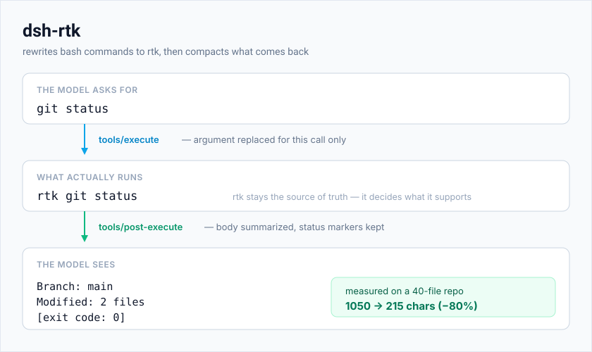

# dsh-rtk

[](https://www.npmjs.com/package/@wingsbutterfly/dsh-rtk)
[](LICENSE)
[](https://nodejs.org)
[](https://github.com/wings1848/dsh-rtk)

给 [DeepSeek Harness](https://github.com/deepseek-ai/dsh)（下称 DSH）用的 RTK 命令重写与工具输出压缩插件。

`dsh-rtk` 在命令派发前把它改写成语义等价的 [rtk](https://github.com/rtk-ai/rtk) 命令，并在工具输出进入模型上下文之前压缩它。支持 `bash`、`pwsh`、`ops_bash` 三类 shell 工具的命令改写，以及 `bash`、`read`、`grep`、`ops_bash`、`ops_grep` 五类工具结果的压缩。

```
模型发出：  git status
实际执行：  rtk git status
模型看到：  Branch: main
            Modified: 2 files
              src/a.ts
```



> **致谢上游。** 本仓库的重构起点是上游项目
> [wings1848/dsh-rtk](https://github.com/wings1848/dsh-rtk)，插件标识、包名
> `@wingsbutterfly/dsh-rtk` 与 `dsh.bundle` 挂载方式都沿用自那里；而它的设计又移植自
> [`pi-rtk-optimizer`](https://github.com/MasuRii/pi-rtk-optimizer)，即把同一套
> rtk 改写/压缩策略搬到 DSH 的插件模型上。本仓库后续的配置模型收敛、客户端配置页与
> 收益面板、交付元数据与合规修复均建立在上述工作之上，感谢原作者的开源。

## 功能

### 命令改写

- 有 rtk 等价命令的调用会在派发前被改写；rtk 不认识的原样执行。
- **rtk 始终是唯一事实来源。** 插件自身不带改写表，而是通过 `rtk rewrite` 询问已安装的二进制，因此支持范围跟随你装的 rtk 版本。
- **两种模式。** `rewrite` 直接替换命令；`suggest` 原样执行、只报告本可使用的等价命令。
- **运行时守卫。** 无法确认 rtk 可用时按原命令执行——缺少优化器永远不会挡住工作。
- 被改写的命令带上插件自己的 `RTK_DB_PATH`（默认 `%TEMP%\dsh-rtk\history.db`），rtk 的使用记录不会落进工作目录，也不会污染终端里的全局台账。
- 子进程环境做脱敏：`*_KEY`、`*_PASSWORD`、`*_SECRET`、`*_TOKEN` 与 `DSH_*` 一律不传给 `rtk rewrite` / `rtk gain` 等外呼进程。

### 输出压缩

对工具结果跑一条多阶段管线：

| 阶段 | 作用 |
|---|---|
| ANSI 剥离 | 去掉终端颜色与格式转义序列 |
| 构建过滤 | 提取编译错误与警告，丢弃进度噪音 |
| 测试聚合 | 折叠为 通过/失败/跳过 计数加失败摘录 |
| Git 压缩 | 归纳 `git status`、`git diff`、`git log` |
| Linter 聚合 | 统计问题数并按规则与文件排序 |
| 搜索分组 | 把 `grep` 风格匹配按文件归组 |
| read 压缩 | `readCompaction: minimal` 删普通注释；`aggressive` 只留 import 与签名（默认关） |
| 硬截断 | 最后兜底的字符预算 |

两条性质是**硬约束**：

- **harness 的结果契约必须存活。** 结果尾部的状态标记——`[exit code: N]`、`[stderr]`、`[timed out after …]`、`[sandbox: …]`——会先被摘出，重写正文后原样接回，并保证永远在最后一行。模型被要求每次调用后检查 `[exit code: N]`，Web UI 也解析同一行来画退出状态。
- **压缩绝不把结果变大。** 某个技术若不能真正缩短文本，就保留原文并且不上报收益。

### 超大输出归 harness 管

挂载 `dsh-spill-policy` 时，它会把完整结果落盘、上下文里只留头尾预览，这种截断是**可恢复的**。本插件的硬截断不可恢复，而且跑在前面：默认 12000 字符的阈值远低于 spill 的 50000 字节阈值，spill 根本见不到大结果，那份"让读者看剩下的部分"的落盘文件也就永远不会生成。

因此只要 spill 服务在场，插件就关掉自己的截断，让失控命令的输出保持可读。是否让位只看服务在不在——没有开关。

### 会话统计

`/rtk stats` 报告本次会话里压缩省下多少字符，按工具和按技术分别统计。

## 安装

**支持的宿主：** dsh 0.1.5、0.1.7、0.2.0、0.2.1（逐条实测，证据见 [`docs/verification.md`](docs/verification.md)）。Node ≥ 22.18。

### 安装插件包

```bash
dsh plugin --profile web add @wingsbutterfly/dsh-rtk
```

插件声明了 `dsh.bundle`（见 [`cordis.patch.yml`](cordis.patch.yml)），所以这条命令**既安装又挂载**：插件管理器把包名追加进 `dsh.profile.bundles`，bundle 层再插入 host 平面的行

```yaml
- id: rtk
  name: '@wingsbutterfly/dsh-rtk'
```

装完需重启宿主——profile 行只在启动时挂载。

> **作用域：host 平面行覆盖该 profile 下的所有会话。** 该行每个宿主进程只实例化一次，它挂的 `tools/execute` / `tools/post-execute` 监听是进程级的：命令改写与输出压缩对该 profile 里的每个 agent、preset、子智能体都生效。bundle patch 表达不了"按 preset 选择性开启"——patch 只能往根列表追加行，loader 也无法扩展 `preset-*.config.plugins`。要收窄就用行自己的开关：`mode: off` 全关，`mode: suggest` 只报告不改写。

**运行期验证过的现象**（宿主 0.2.1-rc.2，实测记录见 `docs/verification.md`）：模型发出的 `ls` 实际执行 `rtk ls`，`cat` 实际执行 `rtk read`，隔离库按工作区累计；插件页显示本地化的标题与图标；行配置页 5 个控件可读可改；`POST /api/dsh-rtk/gain` 在带 cookie 时返回真实台账、无 cookie 时 401。

### 只想按 preset 开

不希望改写覆盖全 profile 时，别走 bundle 通道：把包装成普通依赖，手工把那行加进目标 preset 的插件列表，并让包名不出现在 `dsh.profile.bundles` 里（CLI 已经加过就删掉）。**不要两处都挂。** 此时插件页会显示"已安装、未激活"，属预期，也是这条路径唯一不算问题的状态。

从源码目录直接跑？把检出目录链到组合能解析到的位置：

```bash
mkdir -p ~/.dsh/node_modules/@wingsbutterfly
ln -s /path/to/dsh-rtk ~/.dsh/node_modules/@wingsbutterfly/dsh-rtk
```

### 机器相关配置

包内 patch 只带可移植的默认值。像 `rtkExecutable` 这种绝对路径，请写在 profile 自己的 `cordis.patch.yml` 里，用**非 insert** 条目覆盖。注意必须重述整个 `config:` 块——patch 对行的 config 是整体替换，不做合并：

```yaml
- id: rtk
  config:
    mode: rewrite
    rtkExecutable: /opt/rtk/bin/rtk
```

### 从手工挂载升级

如果 profile 的 `cordis.patch.yml` 里还留着当年手写的 `- insert:` 行，再装 bundle 会把同一行挂两次。删掉手工 insert 块，只保留上面那种非 insert 覆盖。

## 配置

所有字段可选，下例即默认值。

```yaml
- id: rtk
  name: '@wingsbutterfly/dsh-rtk'
  config:
    mode: rewrite                    # off | rewrite | suggest
    compact: true                    # 是否压缩工具输出
    maxChars: 12000                  # 字符预算（1000–200000）
    readCompaction: none             # none | budget | minimal | aggressive
    rtkExecutable: rtk               # 名字或绝对路径，空串表示自动探测
```

> **从旧 schema 升级。** 废弃字段会被迁移而不是静默忽略：`enabled: false` → `mode: off`，`outputCompaction.enabled` → `compact`，`truncate.maxChars` → `maxChars`，三个 read 压缩字段收敛成 `readCompaction`（关 → `none`；开启且 `minimal`/`aggressive` → 对应档位；开启但不过滤 → `budget`）。其余被删的开关固定为原先的默认行为；spill 让位改为"看服务在不在"，不再可配。迁移只看"新字段是否仍是 schema 默认值"，因此用户恰好把新字段设成默认值时无法与"未设置"区分——这是迁移语义本身的边界。

`rtkExecutable` 会**自动探测**：加载时先在 PATH 里查，Windows 上还会查 WinGet、cargo、Scoop 的常见安装目录（每个候选都用 `--version` 验一遍），找到就把绝对路径写回该设置；都没找到就写空串，即自动状态。手填过的值永不被覆盖。

配置也可以在 DSH 的设置文档里实时修改，改完无需重启。出现位置随宿主代际不同：dsh 0.1.7+ 作为独立的设置条目，名字取组合行的 id（上例即 `rtk`）；0.1.5 则是 `dsh-rtk` 命名空间。两种情况下，组合里的 `config:` 提供基础层、设置文档提供用户层覆盖，`/rtk path` 会报告插件实际看到的是哪一层。设置服务代际未知只损失在线编辑能力，插件降级为"仅组合配置"而不是加载失败。

> **行放在哪里决定设置能否写入（dsh 0.1.7+）。** 放在家目录 patch（`~/.dsh/cordis.patch.yml`）里的行是只读的：服务会拒绝"写了也会被下层覆盖"的写入，`/rtk reset` 会如实报告这次拒绝。要保留在线编辑，请把行放进某个 profile 的组合。

> **为什么 `readCompaction` 默认 `none`。** 过滤或截断 `read` 结果，会让模型手里那份副本与磁盘文件不一致，而编辑正是对着副本写的。其余默认开启的技术对正文要么无损、要么只替换整段输出的形态。

### 插件页里的配置界面

装好并重启 Web 宿主后，打开 **插件 → 本包 → 行 `rtk` → 配置**，就是插件自己的配置页：五个字段（模式、压缩开关、字符预算、read 压缩、rtk 路径）带"已覆盖/恢复默认"操作与只读提示；保存走宿主设置服务，立即生效。

表单下方是 **收益（Gain）** 面板。数据经宿主带鉴权的 `/api` 前缀下的 **exact Fetch 路由** `POST /api/dsh-rtk/gain` 取得，内部执行 `rtk gain -d -f json`，并且始终把 `RTK_DB_PATH` 指向本插件的隔离库——绝不是终端里的全局台账。面板把 rtk 的按天数据切成 **今日 / 近 7 天 / 近 30 天 / 全部**，可按**工作区**过滤（`rtk gain -p` 的时间窗下推到 SQL），并画与 rtk CLI 相同的 20 格效率条。工作区下拉优先用宿主自己的项目列表（`workspaceRegistry.list()`），该服务缺失时才退回台账里的 `project_path` 历史。第二个开关在**按天**与**按命令**之间切换：按命令的聚合来自插件库的 `commands` 表，因为 `rtk gain` 的 JSON 与 CSV 都不带按命令明细。数字直接摆明：**原始输出**、**rtk 处理后**、**省下（及占比）**，每个表头都带解释性 tooltip。报告缓存 30 秒，**刷新**会绕过缓存。没有 Web connection 的部署会显示明确的"台账不可用"，而不是坏掉的页面。

该页面是浏览器半边（`exports["./client"]` + `dsh.client`），注册键是「包名#行 id」即 `@wingsbutterfly/dsh-rtk#rtk`。没有客户端半边的旧安装不会出现"配置"入口，但配置仍会通过组合的 `config:` 层与设置文档生效。

## 命令

| 命令 | 说明 |
|---|---|
| `/rtk` | 显示配置与运行状态 |
| `/rtk show` | 同 `/rtk` |
| `/rtk path` | 配置来自哪一层 |
| `/rtk verify` | 检查 rtk 可执行文件是否可用 |
| `/rtk stats` | 本次会话的压缩收益 |
| `/rtk gain [flags]` | 本插件改写过的命令在 rtk 台账里的收益；flags 原样透传（如 `-H`、`-g`、`-f json`）。读的是插件隔离库，所以在终端里直接跑 `rtk gain` 看到的是另一个全局库 |
| `/rtk clear-stats` | 清零收益计数 |
| `/rtk reset` | 恢复配置默认值（失败时如实报告，而不是假装成功） |
| `/rtk help` | 用法说明 |

## 工作原理

两半都挂在工具管线上，而不是去包装某个工具，因为 DSH 正好提供了两个合适的接缝：

- **改写挂在 `tools/execute`。** `tools/pre-execute` 被设计为不可修改参数——参数在派发前就已记录并展示，在那里改写会让"记录下来的调用"与"真正跑的调用"不一致。around-dispatch 阶段是唯一允许执行内容不同的位置，插件把改动严格限制在单次调用内：dispatch 一返回就恢复原始参数，后续流水线与会话日志看到的仍是模型发出的内容。
- **压缩挂在 `tools/post-execute`**，也就是允许替换结果内容的阶段。

两个监听都注册在"该行被挂载到的作用域"里：preset 行只覆盖它自己的 agent（preset 的 standing scope 是每个加入会话的祖先），host 行覆盖进程内所有 agent。

优化本身只需要 `tools` 服务。`settings` 是**升级项而非前置条件**：它异步注册（要先读设置文档），插件先按组合的 `config:` 启动，等服务出现再换成实时集成。没有该服务的组合照样改写与压缩，而不会把整行停掉；未知代际的设置界面降级为"仅组合配置"，不会让插件崩掉。`commands` 与 `systemPrompt` 都通过 `ctx.get` 取，缺任一也不影响优化功能。

### 注意：改写所用的接缝不是官方扩展点

DSH 文档对 `tools/execute` 包装器的措辞是"只允许修改 `exec.signal`"。替换 `arguments` **不是**受支持的扩展点——它能工作，是因为执行对象在结果被通知之前没有被冻结；而失败的替代方案更糟：`tools/pre-execute` 明确不允许改写输入，同一层里也无法用同名工具覆盖注册。

插件是有意识地使用这个接缝的，并在能补偿的地方补偿：替换只作用于单次调用、在 `finally` 里恢复，所有失败路径都退回模型发出的原命令。若未来宿主提前冻结执行对象，改写会**静默失效而不是报错**——命令按原样执行，压缩不受影响，因为 `tools/post-execute` 本身是文档化的内容替换阶段。

## 与 pi-rtk-optimizer 的差异

| pi-rtk-optimizer | dsh-rtk |
|---|---|
| 在 `tool_call` 钩子里改 `event.input.command` | 仅在单次 dispatch 期间替换 `exec.arguments`，结束后恢复 |
| 在 `tool_result` 钩子里压缩 | 在 `tools/post-execute` 瀑布里压缩 |
| `/rtk` 打开 TUI 设置弹窗 | `/rtk` 输出状态文本；配置放在 DSH 设置文档与插件页表单里 |
| 配置是它自己的 JSON 文件 | 配置是 DSH 设置命名空间，叠在组合的 `config:` 块之上 |
| 通过 `tool_execution_*` 钩子净化流式输出 | 宿主没有等价钩子，因此不净化流式输出 |
| 有 Windows 专用 shell 修补 | 未移植；目标部署是 POSIX 与 Windows 的 pwsh 工具 |

其余部分——改写委托给 `rtk rewrite`、退出码契约、rtk 缺失时的守卫、各压缩开关的默认值、每个技术的算法——均按原样移植。

## 开发

```bash
pnpm install          # 或手工链接 peer 包
pnpm run typecheck    # 用真实宿主类型跑 tsc --noEmit
pnpm test             # 先构建，再跑 node --test test/
pnpm run build        # 产出 lib/
pnpm run check        # typecheck + test
```

测试导入的是 `lib/`，所以 `pnpm test` 会先构建；否则改了 `src/` 却没构建，测试会静默通过旧产物。

验收证据——包括独立评审与实测暴露的缺陷——见 [docs/verification.md](docs/verification.md)。

`test/integration.test.ts` 通过替身上下文驱动真实的 `apply()`，并调用真实的 `rtk` 二进制；没装 rtk 的机器上改写用例会被跳过。这个缺口是有意保留并写明的：改写决策**就是**功能本身，用桩只能证明桩能跑。

## 致谢

- 上游项目：[wings1848/dsh-rtk](https://github.com/wings1848/dsh-rtk)——本仓库的重构基础；
- 设计来源：[`pi-rtk-optimizer`](https://github.com/MasuRii/pi-rtk-optimizer)（MIT）；
- 命令改写与节省统计：[rtk](https://github.com/rtk-ai/rtk)（Apache-2.0）；
- 宿主与插件规范：[DeepSeek Harness](https://github.com/deepseek-ai/dsh)。

## 许可证

MIT
